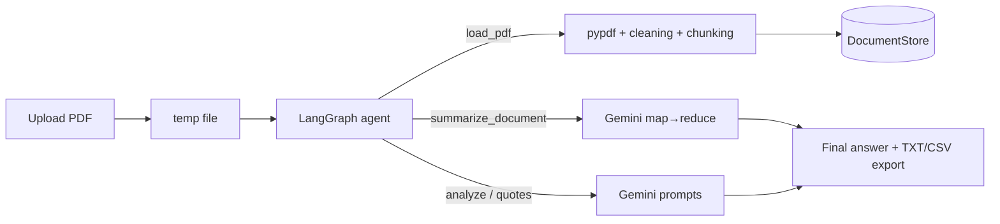

# Agentic PDF Summarizer

A Streamlit app that summarizes PDF documents with **Google Gemini** through a
**LangGraph-backed LangChain agent**. The agent chooses which tools to call: it can
load a PDF, summarize it, analyze its structure and extract key quotes.

Based on the structure of
[niti007/pdfsummarizer-gemini](https://github.com/niti007/pdfsummarizer-gemini),
extended with an agentic tool-calling architecture, tests and CI.

## Project status

- [x] Phase 0 — validate Gemini API key and GitHub login
- [x] Phase 1 — project foundation, config and Streamlit skeleton
- [x] Phase 2 — PDF ingestion and chunking
- [x] Phase 3 — LangGraph agent with tools
- [x] Phase 4 — full Streamlit UI
- [x] Phase 5 — hardening and documentation
- [ ] Phase 6 — publish to GitHub

## How it works



## Agent tools

| Tool | Purpose |
| --- | --- |
| `load_pdf(file_path)` | Extract, clean and chunk a PDF; returns a `doc_id` |
| `summarize_document(doc_id, style)` | Map→reduce summary in the chosen style |
| `analyze_document_structure(doc_id)` | Sections and themes |
| `extract_key_quotes(doc_id)` | Verbatim quotes |
| `list_loaded_documents()` | Inventory of loaded files |

Summary styles: `brief`, `detailed`, `bullet_points`, `executive`.

## Setup

Requires Python 3.10+.

```powershell
python -m venv .venv
.venv\Scripts\activate
pip install -r requirements.txt
copy .env.example .env
```

Put your Gemini API key in `.env` (get one at <https://aistudio.google.com/apikey>):

```
GEMINI_API_KEY=your_real_key_here
```

Optional settings:

```
GEMINI_MODEL=gemini-3.1-flash-lite
CHUNK_TOKENS=1000
OVERLAP_TOKENS=100
```

Never commit `.env`.

## Run

```powershell
.venv\Scripts\python.exe scripts\validate_phase0.py
streamlit run app.py
```

Then open the URL Streamlit prints (usually <http://localhost:8501>).

## Development

```powershell
pip install -r requirements-dev.txt
pytest
ruff check .
.venv\Scripts\python.exe scripts\check_secrets.py
```

See [WALKTHROUGH.md](WALKTHROUGH.md) for a fuller guide and troubleshooting notes.

## Project structure

```
app.py              Streamlit UI, session state and exports
agent.py            LangGraph agent construction and invocation helpers
tools.py            Agent-callable tools
summarizer.py       Gemini calls and map→reduce logic
prompts.py          Prompt templates and summary styles
pdf_processor.py    PDF extraction, cleaning, token chunking, DocumentStore
config.py           Environment-backed settings
utils.py            Formatting, masking and export helpers
scripts/            Validation and secret-check scripts
tests/              Offline unit tests with fake chat models
```

## Troubleshooting

- **"No extractable text"** — the PDF is likely scanned images; run OCR first.
- **429 / rate limits** — wait and retry, or use a smaller document / different model.
- **Model not found (404)** — set `GEMINI_MODEL` to a model your key can access.
- **API key error** — confirm `.env` sits next to `app.py` and contains a valid key.
